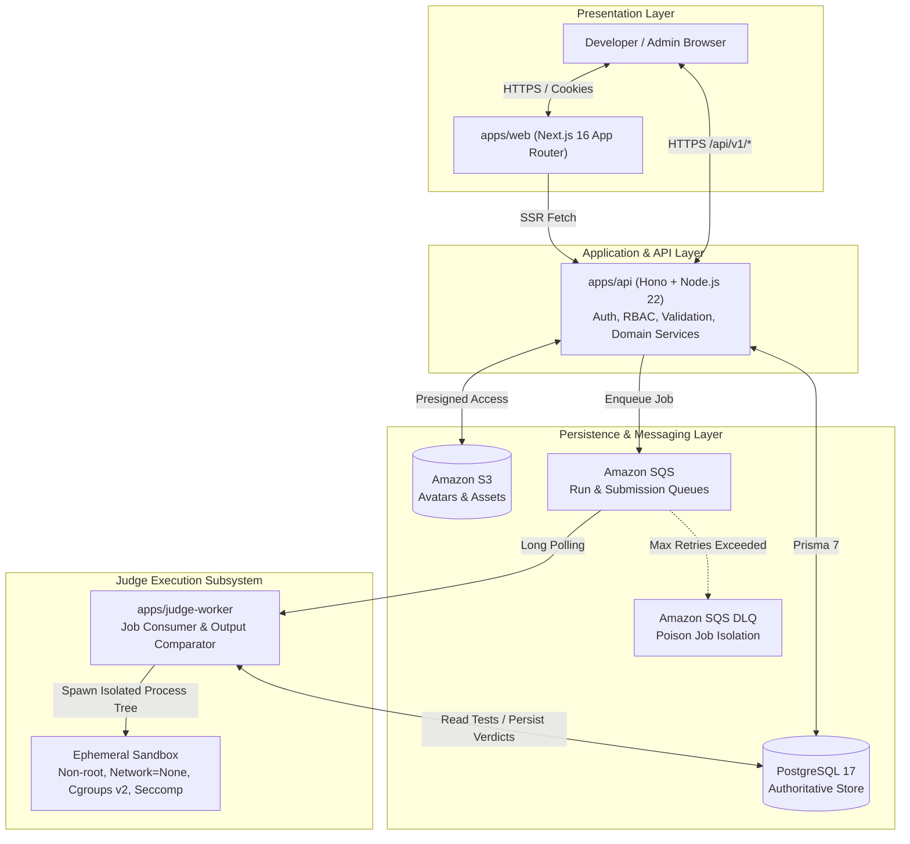

# DevArena Architecture

## 1. System Overview

DevArena is a competitive programming platform architected around six strictly separated concerns:

1. **Presentation (`apps/web`)**: Next.js 16 App Router serving server-rendered public pages and a client-heavy Coding Arena.
2. **Application & API (`apps/api`)**: Stateless Hono HTTP server handling authentication, authorization, input validation, rate limiting, and domain orchestration.
3. **Persistent Data (`PostgreSQL`)**: Authoritative relational datastore managed via Prisma ORM 7 (`@prisma/adapter-pg`).
4. **Asynchronous Queueing (`Amazon SQS`)**: Decouples submission and sample-run requests from code execution, providing retry management and dead-letter isolation.
5. **Judge Orchestration (`apps/judge-worker`)**: Independently scalable worker service that polls SQS, orchestrates compilation and test execution, compares outputs deterministically, and persists verdicts idempotently.
6. **Isolated Execution Sandbox**: Ephemeral, unprivileged, network-isolated Linux sandbox (`nsjail` / `bubblewrap` + cgroups v2 + seccomp-BPF on AWS Bottlerocket) where hostile user code is compiled and executed.

## 2. Workspace Boundaries

| Workspace Package        | Responsibility                                                              | Allowed Internal Imports                                          | Forbidden Imports                                                |
| :----------------------- | :-------------------------------------------------------------------------- | :---------------------------------------------------------------- | :--------------------------------------------------------------- |
| `apps/web`               | Browser UI, SSR pages, Coding Arena                                         | `@devarena/api-contracts`, `@devarena/shared`                     | `@devarena/config`, `@prisma/client`, `pg`, Node `child_process` |
| `apps/api`               | HTTP transport, auth, RBAC, domain services, Prisma DB access, SQS producer | `@devarena/api-contracts`, `@devarena/config`, `@devarena/shared` | `apps/web`, `apps/judge-worker`, `child_process` for user code   |
| `apps/judge-worker`      | SQS consumer, language runners, sandbox orchestration, output comparison    | `@devarena/api-contracts`, `@devarena/config`, `@devarena/shared` | `apps/web`, HTTP route controllers                               |
| `packages/api-contracts` | Browser-safe Zod request/response schemas and DTO types                     | `@devarena/shared`                                                | `@devarena/config`, Prisma, Node-only modules, secrets           |
| `packages/config`        | Server and worker environment variable validation                           | `@devarena/shared`                                                | Browser modules                                                  |
| `packages/shared`        | Zero-dependency domain constants, enums, and pure TypeScript types          | None                                                              | All external runtime packages                                    |

## 3. Non-Negotiable Architectural Invariants

1. **Zero API Code Execution**: `apps/api` must never compile or execute user-submitted code (`child_process.exec`, `eval`, `vm`, or shell interpolation are strictly prohibited).
2. **Authoritative Deterministic Judge**: Only `apps/judge-worker` can transition a submission to a terminal verdict (`ACCEPTED`, `WRONG_ANSWER`, etc.) based on deterministic test execution. AI features (Phase 14) are advisory only and never judge code.
3. **Hidden Test Case Opacity**: Hidden test cases (`isPublic = false`) are never returned by public problem endpoints or exposed in user-visible `SubmissionTestResult` payloads.
4. **Server-Trusted Configuration**: Language compile/run commands, time limits, memory limits, contest windows, user roles, and ratings are resolved exclusively on the server.
5. **Genuine Health & Readiness**:
   - `GET /health` verifies process liveness (`200 OK`).
   - `GET /ready` actively verifies downstream dependencies (`SELECT 1` against PostgreSQL) and returns `503 Service Unavailable` when dependencies are unreachable.
   - Graceful shutdown handlers (`SIGTERM`, `SIGINT`) stop accepting new requests/jobs and cleanly close database connections before exiting.
