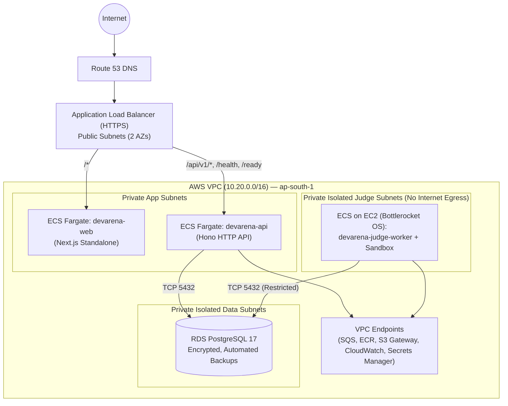

# DevArena AWS Architecture & Cost Model

## 1. Production Deployment Topology

DevArena is designed for deployment to AWS (`ap-south-1` default region) using **Terraform** (`infra/terraform/`) as the single Infrastructure-as-Code system.

- **Web & API Compute**: `apps/web` and `apps/api` run as stateless non-root containers on **Amazon ECS Fargate** in private application subnets behind an **Application Load Balancer (ALB)**.
- **Judge Worker Compute**: `apps/judge-worker` runs on **Amazon ECS backed by EC2 with the AWS Bottlerocket AMI** in dedicated isolated private subnets with **no internet egress**, enabling full kernel support for `nsjail` / `bubblewrap` namespaces, cgroups v2, SELinux enforcing mode, and seccomp-BPF sandboxing.
- **Persistence & Messaging**: **Amazon RDS PostgreSQL 17** (private data subnets), **Amazon SQS** (run queue, submission queue, and dead-letter queue), and **Amazon S3** (avatars and problem assets).

## 2. IAM Least-Privilege Matrix

Each workload uses a dedicated IAM Task Role with narrowly scoped permissions (no wildcard `*` resource policies where resource ARNs are known):

| Principal                             | Allowed AWS Actions                                                                                                                                                  | Explicitly Denied / Excluded                                                   |
| :------------------------------------ | :------------------------------------------------------------------------------------------------------------------------------------------------------------------- | :----------------------------------------------------------------------------- |
| **`devarena-api` Task Role**          | `sqs:SendMessage` (Run & Submit queues), `s3:PutObject` / `s3:GetObject` (scoped to `S3_BUCKET` avatar/asset prefixes)                                               | `sqs:ReceiveMessage`, `sqs:DeleteMessage`, `rds:*`, `iam:*`, `ecs:*`           |
| **`devarena-judge-worker` Task Role** | `sqs:ReceiveMessage`, `sqs:DeleteMessage`, `sqs:ChangeMessageVisibility`, `sqs:GetQueueAttributes` (scoped to Judge queues)                                          | `s3:ListAllMyBuckets`, `secretsmanager:ListSecrets`, `iam:*`, `ec2:*`, `ecs:*` |
| **ECS Task Execution Role**           | Pull images from `devarena/*` ECR repositories, write logs to `/devarena/*` CloudWatch Log Groups, read pinned secret ARNs from Secrets Manager at container startup | Runtime application access (not exposed to container processes)                |
| **Judge Sandbox Child Process**       | **Zero AWS Permissions** (`CLONE_NEWNET` blocks all network access; `IMDSv2` hop limit set to `1` on Bottlerocket host; `env -i` strips all environment variables)   | All network, host filesystem, and metadata access                              |

## 3. Service-by-Service Cost & Scaling Assessment

| AWS Service                                  | Purpose                                               | Always Running?                                                         | Scaling Trigger                                                           | Local Dev Equivalent                                      | Cost Control Strategy                                                                                                                |
| :------------------------------------------- | :---------------------------------------------------- | :---------------------------------------------------------------------- | :------------------------------------------------------------------------ | :-------------------------------------------------------- | :----------------------------------------------------------------------------------------------------------------------------------- |
| **ECS Fargate (`web` & `api`)**              | Serves Next.js SSR and Hono API                       | Yes (min 1 task each in low-cost prod; 2 in HA)                         | ALB RequestCountPerTarget & CPU > 70%                                     | `pnpm dev` (`next dev` + `tsx watch`)                     | Right-size tasks at `0.25 vCPU / 0.5 GB` (`~$9/mo` per task); use Graviton2 (`ARM64`) for ~20% price/performance savings             |
| **ECS on EC2 Bottlerocket (`judge-worker`)** | Runs `apps/judge-worker` and isolated Linux sandboxes | Configurable (min 1 `t4g.small` / `c7g.medium` or scale-to-0 when idle) | ECS Capacity Provider scaling on SQS `ApproximateNumberOfMessagesVisible` | Local `apps/judge-worker` + Docker                        | Use `ARM64` Graviton (`t4g.small` `~$11/mo` or `c7g.medium` `~$26/mo`) with Auto Scaling to 0 during extended idle windows           |
| **RDS PostgreSQL 17**                        | Authoritative relational database                     | Yes                                                                     | Storage autoscaling (`gp3`); vertical instance resize                     | `postgres:17-alpine` (`infra/local/postgres/compose.yml`) | Start with Single-AZ `db.t4g.micro` (`~$13/mo` or Free Tier) + `20 GB gp3`; enable Multi-AZ only for high-availability contest tiers |
| **Amazon SQS + DLQ**                         | Asynchronous judge job queues                         | Serverless (Pay-per-request)                                            | Automatic                                                                 | ElasticMQ / LocalStack                                    | Enable 20-second Long Polling (`WORKER_POLL_WAIT_SECONDS=20`) so idle polling stays within the 1M requests/month Free Tier           |
| **Amazon S3**                                | Avatars and static problem assets                     | Serverless (Pay-per-GB)                                                 | Automatic                                                                 | Local filesystem / MinIO                                  | Lifecycle policy aborts incomplete multipart uploads after 1 day                                                                     |
| **CloudWatch Logs**                          | Structured JSON logs & metrics                        | Serverless (Pay-per-GB)                                                 | Automatic                                                                 | Console stdout                                            | Enforce 14-day retention on application/worker logs and 90-day retention on security audit logs                                      |

## 4. Unresolved Infrastructure Decisions (Recorded for Phase 9)

Rather than assuming production sizing prematurely, the following infrastructure parameters are explicitly recorded for confirmation prior to Phase 9 Terraform execution:

1. **Judge Worker Idle Baseline (`min_size = 0` vs `min_size = 1`)**: Scaling the Bottlerocket Auto Scaling Group to `0` eliminates idle EC2 compute cost entirely but introduces a `~60–90s` cold-start when the first submission arrives after an idle period; keeping `min_size = 1` on a `t4g.small` costs `~$11/mo` and provides instant `<1s` job pickup.
2. **VPC Endpoint vs. NAT Gateway Tradeoff**: Interface VPC Endpoints for ECR, SQS, CloudWatch Logs, and Secrets Manager cost `~$7.20/mo` per endpoint per AZ, whereas a single NAT instance or scheduled image caching on Bottlerocket can reduce fixed networking overhead in low-budget deployments.
3. **Custom Domain & ACM Certificate**: Domain name and Route 53 Hosted Zone ID to bind to the ALB HTTPS listener during Phase 9.
