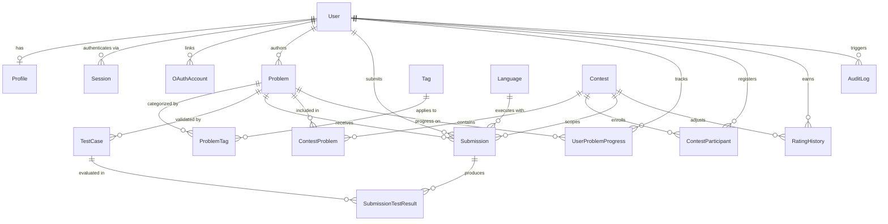

# DevArena Database Architecture & Repository Layer

## 1. Overview

DevArena uses **PostgreSQL 17** as its single authoritative relational datastore and **Prisma ORM 7** (`prisma-client` generator with `@prisma/adapter-pg`) for schema management, versioned SQL migrations, and type-safe queries.

- **Ownership Boundary**: Database connections (`apps/api/src/db`) and repositories (`apps/api/src/repositories`) live exclusively in `apps/api`. Browser bundles (`apps/web`) and shared contracts (`packages/api-contracts`, `packages/shared`) never import Prisma.
- **Generated Client**: `apps/api/src/generated/prisma` is a build artifact excluded via `.gitignore` and generated via `pnpm db:generate` prior to typechecking and builds.

## 2. Entity-Relationship Diagram

## 3. Migration History & Phase 2 Schema Reconciliation

The migration history in `apps/api/prisma/migrations/` preserves the initial migration (`20260922145432_init`) unchanged and upgrades the schema non-destructively via `20261017000000_phase2_schema_reconciliation`:

| #   | Spec Section       | Reconciliation Implemented in `20261017000000_phase2_schema_reconciliation`                                                                                                                                                                                                                                                                                                                  |
| :-- | :----------------- | :------------------------------------------------------------------------------------------------------------------------------------------------------------------------------------------------------------------------------------------------------------------------------------------------------------------------------------------------------------------------------------------- |
| 1   | Sec 23, 28         | Added nullable `User.passwordHash` (`VARCHAR(512)`), `Session` table (with unique `tokenHash`, `expiresAt`, `revokedAt`, `ipAddress`, `userAgent`), and `OAuthAccount` table (`OAuthProvider`: `GITHUB`, `GOOGLE`).                                                                                                                                                                          |
| 2   | Sec 23, 44, 46, 47 | Added `rating` (`1200`), `maxRating` (`1200`), `rankTitle` (`'Unrated'`), `solvedCount` (`0`), `attemptedCount` (`0`), and `contestCount` (`0`) to `Profile` with composite leaderboard indexes `(rating DESC, solvedCount DESC)` and `(solvedCount DESC, rating DESC)`.                                                                                                                     |
| 3   | Sec 19, 20, 24, 27 | Added `REVIEW` to `ProblemStatus`; added `ComparisonMode` enum (`EXACT`, `TRIM_WHITESPACE`, `TOKEN_WHITESPACE`, `FLOAT_TOLERANCE`, `CUSTOM_CHECKER`); added `examples` (`JSONB`), `editorial`, `authorId` (`FK -> User`), `sourceSizeLimitBytes` (`65536`), `comparisonMode`, and `floatTolerance` to `Problem`.                                                                             |
| 4   | Sec 26             | Added `explanation`, `weight` (`1`), `group`, and `updatedAt` to `TestCase`.                                                                                                                                                                                                                                                                                                                 |
| 5   | Sec 18, 36         | Upgraded `SubmissionStatus` losslessly to canonical specification verdicts (`QUEUED`, `RUNNING`, `ACCEPTED`, `WRONG_ANSWER`, `COMPILATION_ERROR`, `RUNTIME_ERROR`, `TIME_LIMIT_EXCEEDED`, `MEMORY_LIMIT_EXCEEDED`, `OUTPUT_LIMIT_EXCEEDED`, `INTERNAL_ERROR`, `CANCELLED`), converting any existing `COMPILE_ERROR` rows to `COMPILATION_ERROR` and `SYSTEM_ERROR` rows to `INTERNAL_ERROR`. |
| 6   | Sec 35, 37, 38, 49 | Added `ExecutionMode` (`PRACTICE`, `CONTEST`), `contestId` (`FK -> Contest`), `idempotencyKey` (`@@unique([userId, idempotencyKey])`), `judgeJobId`, `judgeAttempts`, and `updatedAt` to `Submission`.                                                                                                                                                                                       |
| 7   | Sec 45             | Added `bestRuntimeMs`, `bestMemoryKb`, and `bestSubmissionId` to `UserProblemProgress`.                                                                                                                                                                                                                                                                                                      |
| 8   | Sec 48, 50         | Upgraded `ContestStatus` (`DRAFT`, `UPCOMING`, `RUNNING`, `ENDED`, `CANCELLED`, mapping `LIVE -> RUNNING` and `FINISHED -> ENDED`) and added `penaltyMinutes`, `solvedCount`, `lastAcceptedAt`, and composite standings index `(contestId, finalScore DESC, penaltyMinutes ASC)` to `ContestParticipant`.                                                                                    |
| 9   | Sec 70, 86         | Implemented idempotent development seed script (`apps/api/prisma/seed.ts`) and server-only repository layer (`apps/api/src/repositories/`).                                                                                                                                                                                                                                                  |

## 4. Repository Layer (`apps/api/src/repositories/`)

All database access is encapsulated in six domain repositories:

1. **`UserRepository` (`user.repository.ts`)**: Atomic user + profile creation, credential lookup, public profile retrieval (excluding email/passwordHash), and database session management (`createSession`, `findActiveSessionByTokenHash`, `revokeSessionByTokenHash`, `revokeAllUserSessions`).
2. **`ProblemRepository` (`problem.repository.ts`)**: Public problem catalogue (`PUBLISHED` only, with batched user solve status), public problem detail (strictly filtering `testCases` to `isPublic = true`), judge execution bundle loader, and admin problem/test-case CRUD + publication workflow (requiring >=1 public and >=1 hidden test case before publishing).
3. **`SubmissionRepository` (`submission.repository.ts`)**: Explicit state machine validation, idempotent submission creation via `(userId, idempotencyKey)`, atomic judge worker claim (`claimSubmissionForJudging`), transactional verdict finalization updating `UserProblemProgress` and `Profile` counters, and ownership-protected retrieval (`findSubmissionByIdForActor`) that masks hidden test-case inputs/outputs for non-admin users.
4. **`ContestRepository` (`contest.repository.ts`)**: Server-side contest state calculation (`computeEffectiveContestStatus`), pre-start problem concealment for `UPCOMING` contests, participant registration, and contest leaderboard queries.
5. **`LeaderboardRepository` (`leaderboard.repository.ts`)**: Indexed global leaderboard pagination and atomic rating history + profile updates.
6. **`AuditRepository` (`audit.repository.ts`)**: Automatic redaction of sensitive keys (`password`, `token`, `secret`, `cookie`) and admin-gated audit log listing.

## 5. Development Seed System (`apps/api/prisma/seed.ts`)

Running `pnpm db:seed` populates local development data idempotently using `upsert`:

- **Production Guard**: Refuses to run if `NODE_ENV === 'production'`.
- **Seeded Accounts**:
  - `admin@dev.devarena.local` (`username: dev_admin`, `role: ADMIN`)
  - `alice@dev.devarena.local` (`username: alice_dev`, `role: USER`)
  - `bob@dev.devarena.local` (`username: bob_dev`, `role: USER`)
- **Password Configuration**: Uses `DEV_SEED_ADMIN_PASSWORD` and `DEV_SEED_USER_PASSWORD` from `.env` (falling back to safe local development defaults in `development`/`test` only) and hashes them deterministically with Node's `crypto.scryptSync`.
- **Seeded Content**: `cpp` and `javascript` languages, 10 canonical tags, 3 `PUBLISHED` problems (`two-sum-indices`, `longest-zero-sum-slice`, `minimum-relay-latency`), and 1 `DRAFT` problem (`draft-binary-search-preview`), each with public and hidden test cases.
