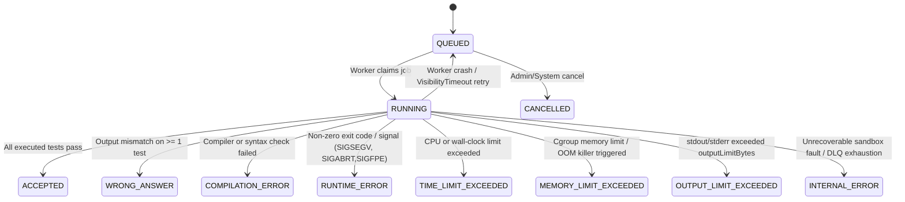

# DevArena Judge Architecture

## 1. Purpose & Core Invariant

The Judge Subsystem (`apps/judge-worker`) is the sole component authorized to compile and execute user-submitted source code.

- **Never Execute in API**: `apps/api` never invokes compilers, interpreters, or shells on user input.
- **Never Trust Client Input**: Language compile/run commands, resource limits, and test-case visibility are resolved exclusively by the backend.
- **Deterministic Authority**: Only deterministic execution inside the isolated judge worker determines verdicts.

## 2. End-to-End Submission & Run Lifecycle

```mermaid
sequenceDiagram
    autonumber
    actor User as Developer (Arena)
    participant API as apps/api
    participant DB as PostgreSQL
    participant SQS as Amazon SQS
    participant Worker as apps/judge-worker
    participant Sandbox as Isolated Sandbox

    User->>API: POST /api/v1/submissions (or /api/v1/runs)
    API->>DB: Validate & Persist Submission (status = QUEUED)
    API->>SQS: SendMessage(submissionId, source=SUBMIT|RUN, traceId)
    API-->>User: 202 Accepted { submissionId, status: "QUEUED" }

    loop Poll GET /api/v1/submissions/:id while QUEUED or RUNNING
        User->>API: GET /api/v1/submissions/:id
        API-->>User: { status, passedTests, totalTests }
    end

    SQS->>Worker: ReceiveMessage (Long Poll 20s)
    Worker->>DB: Atomic claim (QUEUED -> RUNNING)
    Worker->>DB: Load Problem limits + TestCases (public only for RUN; all for SUBMIT)
    Worker->>Sandbox: Prepare ephemeral tmpfs workspace + Compile (if C++)
    alt Compilation Error
        Sandbox-->>Worker: Non-zero exit + compiler stderr
        Worker->>DB: Persist status = COMPILATION_ERROR, errorMessage = stderr
    else Compilation Succeeded
        loop Each TestCase in sequence order
            Worker->>Sandbox: Execute binary/script with stdin = TestCase.input
            Sandbox-->>Worker: stdout, stderr, exitCode, timeMs, memoryKb, signal/oom status
            Worker->>Worker: Compare stdout vs expectedOutput
            Worker->>DB: Upsert SubmissionTestResult
        end
        Worker->>DB: Transaction: Set final verdict + Update Progress & Contest Score
    end
    Worker->>SQS: DeleteMessage
```

## 3. Submission State Machine



### Valid State Transitions

- `QUEUED -> RUNNING | CANCELLED | INTERNAL_ERROR`
- `RUNNING -> QUEUED` (only via SQS retry when worker crashes before completion and `judgeAttempts < 3`)
- `RUNNING -> ACCEPTED | WRONG_ANSWER | COMPILATION_ERROR | RUNTIME_ERROR | TIME_LIMIT_EXCEEDED | MEMORY_LIMIT_EXCEEDED | OUTPUT_LIMIT_EXCEEDED | INTERNAL_ERROR`
- Terminal verdicts are **immutable** unless an administrator explicitly triggers an audited rejudge.

## 4. `RUN` vs. `SUBMIT` Semantics

| Attribute                      | `RUN` (`POST /api/v1/runs`)                                                          | `SUBMIT` (`POST /api/v1/submissions`)                                                                                  |
| :----------------------------- | :----------------------------------------------------------------------------------- | :--------------------------------------------------------------------------------------------------------------------- |
| **Test Cases Executed**        | Public sample test cases only (`isPublic = true`)                                    | All test cases (`isPublic = true` and `isPublic = false`)                                                              |
| **Output Visibility**          | Returns per-test Input, Expected Output, Actual Output, Runtime, Memory, and Verdict | Exposes Input/Expected/Actual for public tests only; hidden tests expose aggregate pass count and overall verdict only |
| **User Statistics & Progress** | Does not increment solved count or affect `UserProblemProgress`                      | Updates `UserProblemProgress`, solved count, and best runtime/memory                                                   |
| **Contest Scoring & Rating**   | Never affects contest score, penalty, or rating                                      | Updates `ContestParticipant` score/penalty when submitted in `CONTEST` mode during a live window                       |

## 5. `LanguageRunner` Abstraction & Pinned Runtimes

Every supported language implements the server-owned `LanguageRunner` contract:

- `validate(sourceCode, limits)` — Enforces maximum source size (`<= 64 KB`) and UTF-8 encoding.
- `prepare(workspaceDir, sourceCode)` — Writes source code to a fixed path (`main.cpp` or `solution.mjs`) with restrictive permissions (`0400`).
- `compile(workspaceDir, compileLimits)` — Executes compilation or static syntax validation inside the sandbox using explicit `argv` arrays (`shell: false`).
- `execute(workspaceDir, inputPath, runLimits)` — Runs the compiled artifact against a single test case inside an isolated sandbox invocation and returns resource metrics (`executionTimeMs`, `memoryUsedKb`, `exitCode`, `signal`, `timedOut`, `oomKilled`, `outputExceeded`).
- `cleanup(workspaceDir)` — Kills any residual processes in the cgroup and removes the ephemeral workspace.

### Initial Pinned Languages

| Language             | Slug         | Pinned Toolchain                                     | Compile / Check Command (`argv`)                                                  | Execution Command (`argv`)                                                                              | Default Limits                                                                                                       |
| :------------------- | :----------- | :--------------------------------------------------- | :-------------------------------------------------------------------------------- | :------------------------------------------------------------------------------------------------------ | :------------------------------------------------------------------------------------------------------------------- |
| **C++ (C++20)**      | `cpp`        | `g++ 14.2.0` (Debian Bookworm / Alpine pinned image) | `['g++', '-std=c++20', '-O2', '-pipe', '-o', '/work/solution', '/work/main.cpp']` | `['/work/solution']`                                                                                    | Compile: 10s wall, 512 MB RAM; Run: `problem.timeLimitMs` (default 2000ms), `problem.memoryLimitMb` (default 256 MB) |
| **JavaScript (ESM)** | `javascript` | `Node.js 22.14.0 LTS`                                | `['node', '--check', '/work/solution.mjs']`                                       | `['node', '--max-old-space-size=192', '--disallow-code-generation-from-strings', '/work/solution.mjs']` | Check: 5s wall, 256 MB RAM; Run: `problem.timeLimitMs` (default 2000ms), `problem.memoryLimitMb` (default 256 MB)    |

## 6. Deterministic Output Comparison

The output comparator (`apps/judge-worker/src/comparator`) normalizes `\r\n` and `\r` to `\n` before applying the problem's configured comparison mode:

1. `TRIM_WHITESPACE` (Default): Strips trailing whitespace on each line and trailing empty lines at the end of output before exact comparison.
2. `EXACT`: Byte-for-byte comparison after line-ending normalization.
3. `TOKEN_WHITESPACE`: Splits output into whitespace-delimited tokens and compares token sequences.
4. `FLOAT_TOLERANCE`: Parses numeric tokens and verifies $\frac{|a - e|}{\max(1, |e|)} \le \epsilon$ (default $\epsilon = 10^{-6}$).
5. `CUSTOM_CHECKER`: Hook for problem-specific deterministic verifier programs in future phases.

## 7. Local Development Judge Parity

Local development preserves the asynchronous queue and worker boundary:

- `apps/api` publishes jobs to a local SQS-compatible queue (ElasticMQ / LocalStack) or local queue adapter.
- `apps/judge-worker` consumes jobs in a separate process/container and executes them through the `LanguageRunner` pipeline—never inside `apps/api`.
